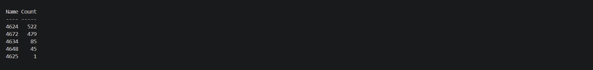
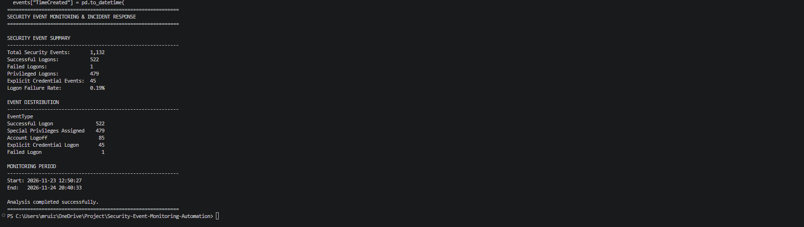
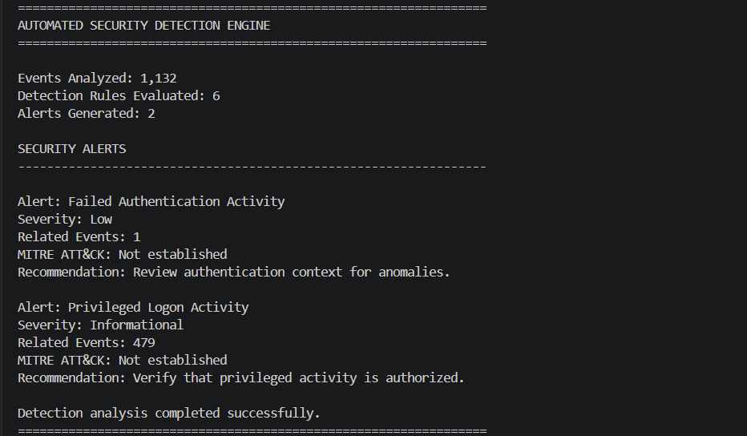
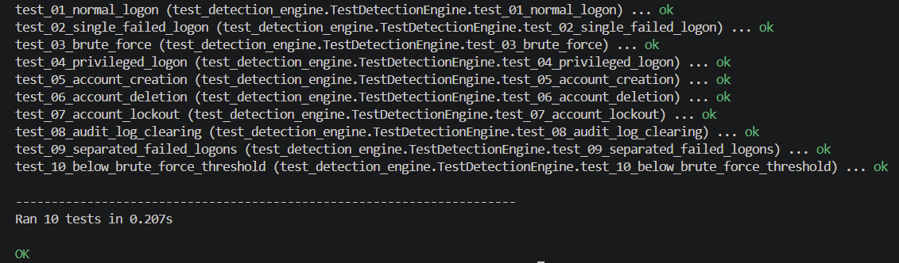
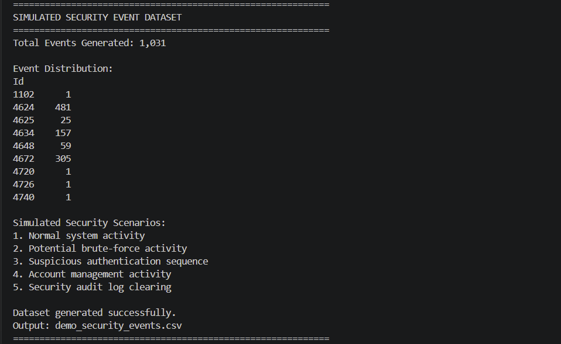
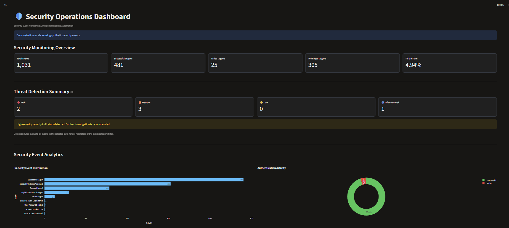
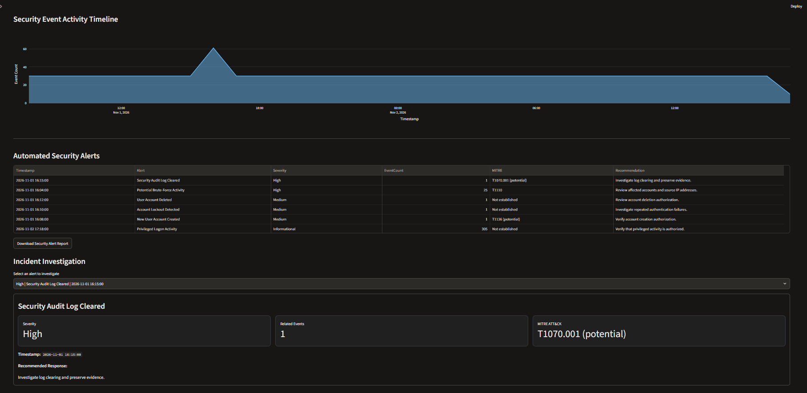
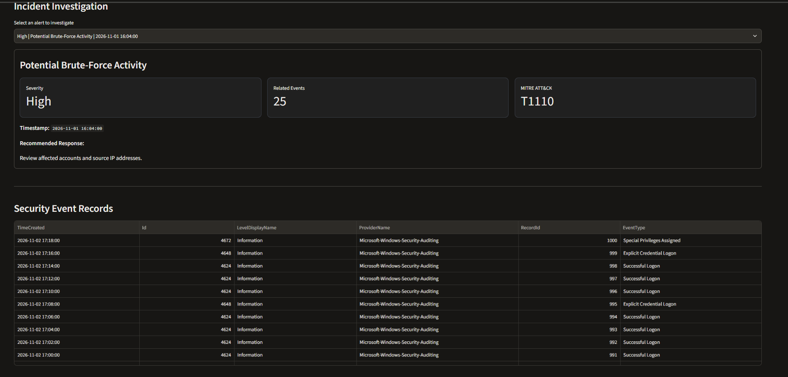
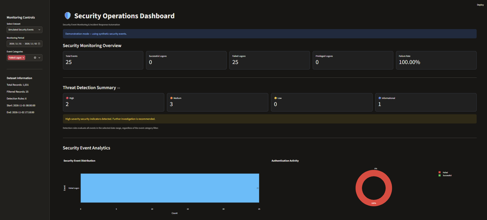
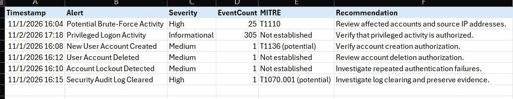

# Security Event Monitoring & Incident Response Automation

## Project Overview

This project demonstrates the development of a Python-based security monitoring and incident investigation application designed to analyze Windows security events, identify potentially suspicious activity, and automate security alert generation and reporting.

The application combines security log analysis, rule-based threat detection, MITRE ATT&CK technique mapping, and an interactive security operations dashboard. Both real Windows security events and a controlled synthetic dataset were used to evaluate the application's functionality and demonstrate practical security monitoring workflows.

## Project Objectives

- Extract and analyze Windows security event logs.
- Automate the identification of potentially suspicious security activity.
- Develop rule-based detection logic with severity classifications.
- Map relevant security indicators to the MITRE ATT&CK framework.
- Build an interactive dashboard for security monitoring and incident investigation.
- Validate detection logic through automated unit testing.
- Generate structured security alert reports to support incident response.

## Tools and Technologies

| Tool / Technology | Purpose |
|---|---|
| Python | Security analysis and detection automation |
| Pandas | Data processing and event analysis |
| Streamlit | Interactive security operations dashboard |
| Plotly | Security data visualization |
| PowerShell | Windows security event extraction |
| Windows Event Viewer | Security log collection |
| MITRE ATT&CK | Threat technique mapping |
| Python unittest | Automated detection rule validation |
| Microsoft Excel | Security alert report review |
| Visual Studio Code | Application development |
| GitHub | Version control and project documentation |

## Project Architecture

```text
Windows Security Logs / Synthetic Dataset
                  |
                  v
         Security Event Processing
                  |
                  v
          Automated Detection Engine
                  |
                  v
      Severity Classification and Mapping
                  |
                  v
        Security Operations Dashboard
                  |
                  v
      Incident Investigation and Reporting
```

## 1. Windows Security Event Collection

Windows Event Viewer and PowerShell were used to extract relevant security events from a local Windows environment.

A total of 1,132 security events were collected and processed for analysis, covering approximately 32 hours of system activity.

| Event ID | Event Description | Recorded Events |
|---|---|---:|
| 4624 | Successful Logon | 522 |
| 4625 | Failed Logon | 1 |
| 4634 | Account Logoff | 85 |
| 4648 | Explicit Credential Logon | 45 |
| 4672 | Special Privileges Assigned | 479 |
| | **Total** | **1,132** |



## 2. Python Security Event Analysis

A Python-based analysis module was developed using Pandas to process security records, normalize timestamps, classify event IDs, and calculate authentication and security activity metrics.

The analysis identified a logon failure rate of approximately 0.19% within the collected Windows security events.

The collected activity did not provide sufficient evidence of a brute-force attack or confirmed security compromise.



## 3. Automated Threat Detection Engine

A rule-based detection engine was developed to evaluate security events and generate alerts based on predefined security conditions.

The engine assigns severity levels, identifies related event counts, provides relevant MITRE ATT&CK mappings where applicable, and generates recommended investigation actions.

### Detection Rules

| Detection Rule | Event ID | Severity | MITRE ATT&CK |
|---|---|---|---|
| Potential Brute-Force Activity | 4625 | High | T1110 |
| Failed Authentication Activity | 4625 | Low | Not established |
| Privileged Logon Activity | 4672 | Informational | Not established |
| New User Account Created | 4720 | Medium | T1136 (Potential) |
| User Account Deleted | 4726 | Medium | Not established |
| Account Lockout Detected | 4740 | Medium | Not established |
| Security Audit Log Cleared | 1102 | High | T1070.001 (Potential) |

The authentication detection rule uses a rolling five-minute window to identify five or more failed logon events as potential brute-force activity.

MITRE ATT&CK mappings represent possible adversarial techniques and do not independently establish malicious intent.



## 4. Detection Rule Validation

Automated unit tests were developed using Python's unittest framework to evaluate the detection engine under controlled security scenarios.

Testing covered:

- Normal authentication activity
- Individual failed authentication attempts
- Repeated failed logons within the detection window
- Privileged logon activity
- User account creation
- User account deletion
- Account lockout events
- Security audit log clearing
- Failed logons outside the detection window
- Authentication activity below the detection threshold

All 10 automated unit tests passed successfully, confirming that the implemented detection rules behaved as expected under the tested conditions.



## 5. Simulated Security Environment

A synthetic dataset containing 1,031 security events was generated to demonstrate security scenarios that were not present in the collected Windows logs.

The dataset includes 1,000 routine security events and 31 additional scenario-based events.

Simulated scenarios include:

- 25 failed authentication attempts within four minutes
- Successful authentication following repeated failures
- Privileged logon activity
- New user account creation
- Account lockout
- User account deletion
- Security audit log clearing

These events were generated programmatically for testing purposes. No actual attacks or system account modifications were performed.



## 6. Security Operations Dashboard

An interactive dashboard was developed using Streamlit and Plotly to provide a centralized interface for reviewing security activity and investigating generated alerts.

### Dashboard Features

- Total security event monitoring
- Successful and failed authentication metrics
- Privileged logon monitoring
- Authentication failure rate calculations
- Security event distribution charts
- Severity-based alert summaries
- Interactive date and event category filters
- Security event timeline visualization
- Detailed incident investigation
- Security alert CSV export functionality



## 7. Security Event Timeline and Alert Prioritization

The dashboard provides an hourly security event timeline and a prioritized alert table to support the identification of unusual activity and security investigation priorities.

The simulated dataset generated six security alerts across three severity classifications.

| Severity | Alerts Generated |
|---|---:|
| High | 2 |
| Medium | 3 |
| Low | 0 |
| Informational | 1 |
| **Total** | **6** |



## 8. Incident Investigation

An interactive investigation interface was implemented to allow users to examine individual security alerts and review associated security information.

Each investigation includes:

- Alert description
- Severity classification
- Detection timestamp
- Related security event count
- Applicable MITRE ATT&CK technique
- Recommended investigation actions

The simulated brute-force scenario identified 25 failed authentication attempts within a four-minute period, exceeding the configured detection threshold.



## 9. Interactive Security Filtering

Date-based and event-category filters allow users to narrow their analysis to specific security activity.

The dashboard maintains detection results across the selected date range while allowing individual event categories to be isolated for further investigation. This prevents event-category filtering from unintentionally removing relevant alerts from the overall security assessment.



## 10. Automated Security Alert Reporting

The application generates structured security alert data that can be exported for documentation, further analysis, and incident response review.

The synthetic alert report contains six generated alerts with timestamps, severity classifications, related event counts, MITRE ATT&CK mappings, and recommended investigation actions.

The CSV report was generated programmatically and reviewed in Microsoft Excel to verify its structure and contents.



## Key Results

| Performance Metric | Result |
|---|---:|
| Real Windows security events analyzed | 1,132 |
| Synthetic security events analyzed | 1,031 |
| Total security events analyzed | 2,163 |
| Detection rule categories implemented | 6 |
| Automated unit tests passed | 10/10 |
| Alerts generated from real dataset | 2 |
| Alerts generated from synthetic dataset | 6 |
| High-severity synthetic alerts | 2 |
| Medium-severity synthetic alerts | 3 |
| Failed logons in simulated brute-force scenario | 25 |
| Real dataset authentication failure rate | 0.19% |
| Synthetic dataset authentication failure rate | 4.94% |

## Project Deliverables

- [Technical Project Report](reports/)
- [Simulated Security Alert Report](reports/Simulated_Security_Alert_Report.csv)
- [Synthetic Security Event Dataset](data/demo_security_events.csv)
- [Security Operations Dashboard Source Code](dashboard.py)
- [Automated Detection Engine](detection_engine.py)
- [Security Event Analysis Module](security_analyzer.py)
- [Automated Unit Tests](tests/test_detection_engine.py)
- [Project Screenshots](screenshots/)

## Security and Privacy

The original Windows security logs and extracted real-event dataset are excluded from this public repository to protect potentially sensitive system information.

The included synthetic dataset allows users to reproduce the dashboard and evaluate detection functionality without requiring access to private security logs.

## Skills Demonstrated

- Security Information and Event Analysis
- Threat Detection and Security Monitoring
- Incident Investigation and Response
- Python Security Automation
- Windows Security Log Analysis
- MITRE ATT&CK Mapping
- Security Data Visualization
- Automated Software Testing
- Security Alert Prioritization
- Technical Documentation

**Marcela Ruiz**

B.S. Information Technology Cybersecurity Concentration  
George Mason University

[LinkedIn](https://www.linkedin.com/in/marcela-ruiz6) | [GitHub](https://github.com/marcela-ruiz)
